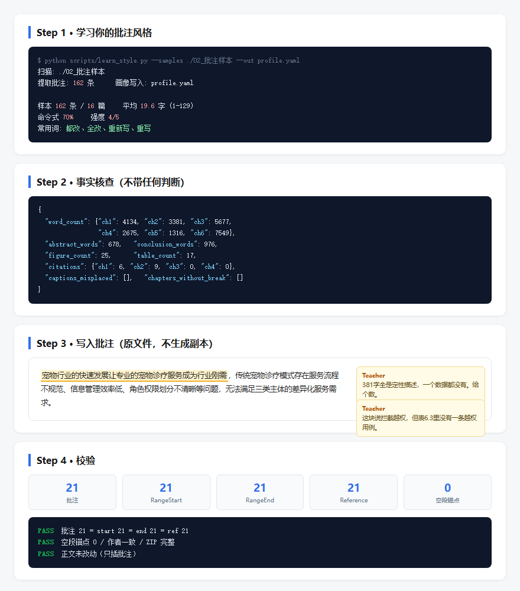

<div align="center">

# 导师审稿 Skills

**把导师审论文这件又累又重复的事，变成一个能自动跑的流程。**

[](https://opensource.org/licenses/MIT)
[](https://www.python.org/downloads/)
[]()

</div>

---

## 先说人话：这是个啥

你是导师，手里 30 个学生，30 篇毕业论文。

每篇你要看格式对不对、图清不清楚、字数够不够、文献真不真。看完还得一条条敲批注。

**一篇 40 分钟。30 篇就是 20 个小时。**

这个技能干的事：

1. **学会你的批注风格** — 拿你以前批过的论文，提取你怎么说话：多长、多狠、爱用哪些词
2. **自动查事实** — 字数、图表数、引用数、题注位置，全量化，不猜
3. **生成候选清单** — 每条都带客观依据，哪一段、什么问题、什么数据支撑
4. **你来确认** — 要不要批，你说了算
5. **写进原文件** — WPS 里一条条跳出来，跟你自己敲的一模一样

**40 分钟一篇，变成 5 分钟一篇。而且批注风格是你自己的。**

---

## 长什么样



从上到下四步：学风格 → 查事实 → 写批注 → 校验。

---

## 为什么叫「自适应」

因为**它是学你，不是学我**。

同一个技能，给不同导师用，产出的批注完全不一样：

| 导师 A（严厉型） | 导师 B（详细型） |
|---|---|
| 全改。 | 第三章第2节的论证逻辑存在跳跃，建议补充中间推导环节。 |
| 图看不清，重画。 | 图3-1分辨率偏低，建议导出300dpi以上版本。 |
| 平均 8 字 | 平均 35 字 |

**它学的是你实际批注过的文本，不是预设的模板。**

---

## 怎么学（实测数据）

拿 16 篇历史批注论文喂进去，提取 162 条批注：

```yaml
name: "你的名字"
samples: 162              # 学到 162 条
files: 16                 # 来自 16 篇论文
length:
  mean: 19.6              # 平均 19.6 字
  min: 1                  # 最短 1 个字
  p50: 12
  p90: 42
tone:
  imperative_pct: 69.8    # 70% 是命令式，不是商量语气
  strength: 4             # 语气强度 4/5
phrases:
  reject: ["都改", "全改", "重新写", "重写"]
  complain: ["太少", "看不清", "太多"]
  reference: ["参考论文", "看群里"]
  minimal: ["改", "单独一页", "断表"]
habits:
  no_explain: true        # 不解释理由，直接说怎么改
  minimal_pct: 13.0       # 13% 的批注是 4 字以内
```

**关键数字：**

- 平均 19.6 字 → 以后生成的批注就该是这个长度
- 70% 命令式 → 不要写"建议作者……"
- 13% 极简 → 该简就简，别啰嗦

换个人用，跑一遍 `learn_style.py`，学到的就是那个人的风格。

---

## 六步流程（每步都有硬约束）

```
Phase 0   备份 + 事实核查  <- 不可跳过
Phase 1   生成候选清单
Phase 2   ★ 你确认（要批/不批/改措辞）
Phase 3   WPS 逐条写入 + 居中滚动
Phase 4   校验（批注数=锚点数，无空段）
Phase 5   出报告（可选）
```

### Phase 0 — 备份 + 事实核查

```bash
python scripts/backup.py "待审/论文.docx"
python scripts/fact_check.py "待审/论文.docx"
```

`backup.py` 干三件事：复制备份、校验 ZIP 完整、校验批注锚点。

`fact_check.py` 输出纯客观数据：

```json
{
  "word_count": {"ch1": 4134, "ch2": 3381, "ch3": 5677,
                 "ch4": 2675, "ch5": 1316, "ch6": 7549},
  "abstract_words": 678,
  "conclusion_words": 976,
  "figure_count": 25,
  "table_count": 17,
  "citations": {"ch1": 6, "ch2": 9, "ch3": 0, "ch4": 0},
  "captions_misplaced": [],
  "chapters_without_break": []
}
```

> **没有这些数据，不许写任何批注。** 这是最硬的一条规矩。

### Phase 2 — 为什么必须让你确认

因为 AI 会瞎猜。

这个技能最早的版本，31 条批注里被我删了 22 条，因为全是无根据的猜测：

| AI 说的 | 实际 |
|---|---|
| 第一章内容太少 | **3756 字，正常** |
| E-R图要拆开 | **已经拆成 15 张** |
| 1.2 没文献 | **有 [3][4] 标注** |
| 图4.2题注在上方 | **就在下方** |

**所以现在强制加了一步：清单先给你看。**

---

## 反误判清单（这个技能最值钱的部分）

每一条都是真的踩过的坑：

| 你以为的问题 | 实际情况 | 必须先查 |
|---|---|---|
| 内容太少 | 3756 字 | 数字数 |
| 4.4 太薄 | 644 字 | 数字数 |
| 结论太少 | 937 字 | 数字数 |
| 图太小看不清 | 图是清晰的 | 看图 |
| 三线表没做 | 18 张都合格 | 看 tcBorders |
| 题注位置错 | 位置是对的 | 看间距 |

### DOCX 里的四个技术坑

| 坑 | 表现 | 解法 |
|---|---|---|
| 图片格式多样 | 漏判导致误判题注位置 | 同时检测 w:drawing / w:pict / w:object / v:imagedata |
| 三线表边框在单元格 | 误判没有三线表 | 查 w:tcBorders，不是 w:tblBorders |
| 目录同名 | 批注锚到目录 | **用段落索引，不用文字搜索** |
| 删批注留孤儿锚点 | WPS 显示空批注 | 同步清 RangeStart/End/Reference |

---

## 一个技术细节：为什么用段落索引不用文字搜索

最早我用 `Find` 按文字搜索定位，结果**11 条批注全堆到目录里的同一个段落**。

原因：目录里也有「第5章 系统实现」「结论」「参考文献」这些字，搜索从文档开头找，第一个就命中了目录。

```python
# 错误做法：会锚到目录
rng.Find.Execute('第5章 系统实现')

# 正确做法：段落索引，绝对准确
{'para': 283, 'text': '...'}
```

---

## 安装

```bash
git clone https://github.com/Jackmaolk/thesis-review-skill.git
cd thesis-review-skill

# 复制到技能目录
cp -r . ~/.agents/skills/thesis-review-comments

# 装依赖
pip install python-docx lxml pyyaml

# 自测
python tests/test_pipeline.py
```

**自测要看到：**

```
通过 13 / 失败 0
```

---

## 快速开始

### 第一步：建目录

```
论文审核/
├── 00_标准/
│   ├── rules.yaml          # 学校格式规则
│   └── profile.yaml        # 你的批注风格（自动生成）
├── 01_范文/                # 往届范文
├── 02_批注样本/            # ★你批过的论文，用于学习
├── 03_待审/                # 本届学生论文
└── 04_输出/                # 批注版 + 报告
```

### 第二步：学你的风格

```bash
python scripts/learn_style.py --samples ./02_批注样本 --out ./00_标准/profile.yaml --name "你的名字"
```

输出：

```
扫描: ./02_批注样本
提取批注: 162 条
画像写入: ./00_标准/profile.yaml

样本 162 条 / 16 篇
平均 19.6 字 (1-129)
命令式 70% 强度 4/5
常用词: 都改、全改、重新写、重写
```

### 第三步：审一篇

```bash
# 备份 + 核查
python scripts/backup.py "03_待审/张三.docx"
python scripts/fact_check.py "03_待审/张三.docx"

# 写批注（会弹 WPS，一条条跳）
python scripts/wps_center.py plan.json

# 校验
python scripts/audit_comments.py "04_输出/张三_批注版.docx"
```

`plan.json` 格式：

```json
{
  "author": "你的名字",
  "delay": 2000,
  "center": 9,
  "issues": [
    {"para": 114, "text": "381字全是定性描述，一个数据都没有。给个数。"},
    {"para": 365, "text": "功能测试6条，第5章列了17个功能，覆盖不住。"}
  ]
}
```

**参数：**

- `author` — 批注显示的名字（必须是你的 WPS 用户名）
- `delay` — 每条停留毫秒（2000 = 2 秒，方便看）
- `center` — 向上滚几行，让目标落在屏幕中间

---

## 参数怎么调

| 参数 | 默认 | 什么时候改 |
|---|---|---|
| `delay` | 2000 | 想看得慢就 3000，批量处理设 200 |
| `center` | 9 | 目标贴底就调大，跑出屏幕就调小 |

---

## 脚本清单

| 脚本 | 作用 | 何时用 |
|---|---|---|
| `learn_style.py` | 从历史批注学风格 | 首次配置 |
| `backup.py` | 备份 + 校验 | 每篇开始前 |
| `fact_check.py` | 事实核查 | 每篇开始前 |
| `wps_center.py` | 写入批注 + 居中滚动 | 确认清单后 |
| `wps_apply.py` | 写入批注（无 UI） | 批量处理 |
| `wps_anchor.py` | 段落定位 | 被上面调用 |
| `format_check.py` | 格式规则检查 | 辅助 |
| `audit_comments.py` | 批注体检 | **写完必跑** |
| `verify_integrity.py` | 正文完整性 | 写完必跑 |
| `make_report.py` | 生成审核报告 | 可选 |

---

## 常见问题

**Q: 为什么必须用 WPS 或 Word，不能直接改 docx？**

A: 可以。`wps_apply.py` 就是直接改 docx 的。`wps_center.py` 只是为了让你看见过程。

**Q: 批注会改正文吗？**

A: **不会。** 只插入批注，正文一个字都不动。

**Q: 学风格要多少样本？**

A: 5 篇起，20 篇更准。太少学不准，太多没必要。

**Q: 能批不同学校的论文吗？**

A: 能。改 `00_标准/rules.yaml` 就行，格式规则是配置不是写死的。

**Q: macOS 能用吗？**

A: `wps_center.py` 依赖 WPS COM，只能在 Windows 用。但 `wps_apply.py` 跨平台。

---

## 局限（说清楚）

1. **不判断学术水平** — 只能查格式和事实，不能判断算法好不好
2. **不替代你** — Phase 2 必须你确认，AI 会瞎猜
3. **只支持 docx** — .doc 要先转
4. **中文为主** — 英文批注也能提取，但词表是中文的

---

## 目录结构

```
thesis-review-skill/
├── SKILL.md                   # 技能主文档（给 AI 看的）
├── README.md                  # 说明（给人看的）
├── profile.example.yaml       # 风格画像模板
├── rules.example.yaml         # 格式规则模板
├── scripts/                   # 12 个脚本
│   ├── learn_style.py         # ★ 风格学习
│   ├── backup.py              # 备份校验
│   ├── fact_check.py          # 事实核查
│   ├── wps_center.py          # 居中批注
│   ├── wps_apply.py           # 精确锚定
│   ├── wps_anchor.py          # 段落定位
│   ├── format_check.py        # 格式检查
│   ├── audit_comments.py      # 批注体检
│   ├── verify_integrity.py    # 完整性
│   ├── make_report.py         # 报告
│   ├── docx_comment.py        # 批注读写
│   └── review.py              # 主流程
├── references/
│   ├── 批注规则.md
│   ├── 要点清单.md
│   ├── 审核规范.md
│   └── 技能调研.md
├── docs/
│   └── images/                # 演示截图
└── tests/
    └── test_pipeline.py       # 端到端测试
```

---

## 实测效果

用一篇 25 张图 / 17 张表 / 6 章的本科论文实测：

```
事实核查:
  ch1=4134字  ch2=3381字  ch3=5677字
  ch4=2675字  ch5=1316字  ch6=7549字
  摘要 678字  结论 976字
  25 图  17 表  15 引用

批注分布:
  前置    1 条（摘要）
  第1章   3 条
  第2章   1 条
  第3章   3 条
  第4章   3 条
  第5章   3 条
  第6章   6 条
  合计   21 条

校验:
  批注 21 | start 21 | end 21 | ref 21  PASS
  空段锚点 0                              PASS
  作者一致                                PASS
```

**每章都有批注，且深入章节中间和结尾，不只是开头。**

---

## 许可

MIT

---

<div align="center">

**审论文这件事，本该把时间花在判断学生水平上，不是用来数图够不够。**

</div>